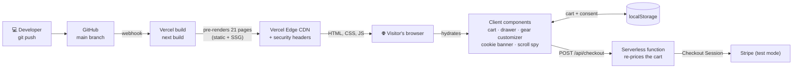
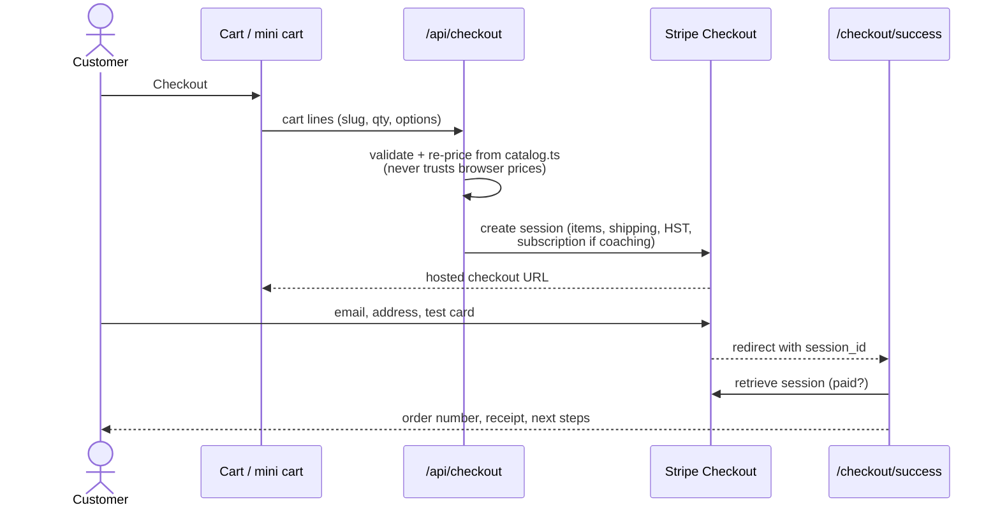
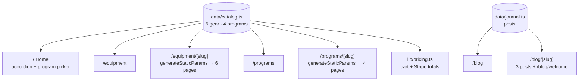
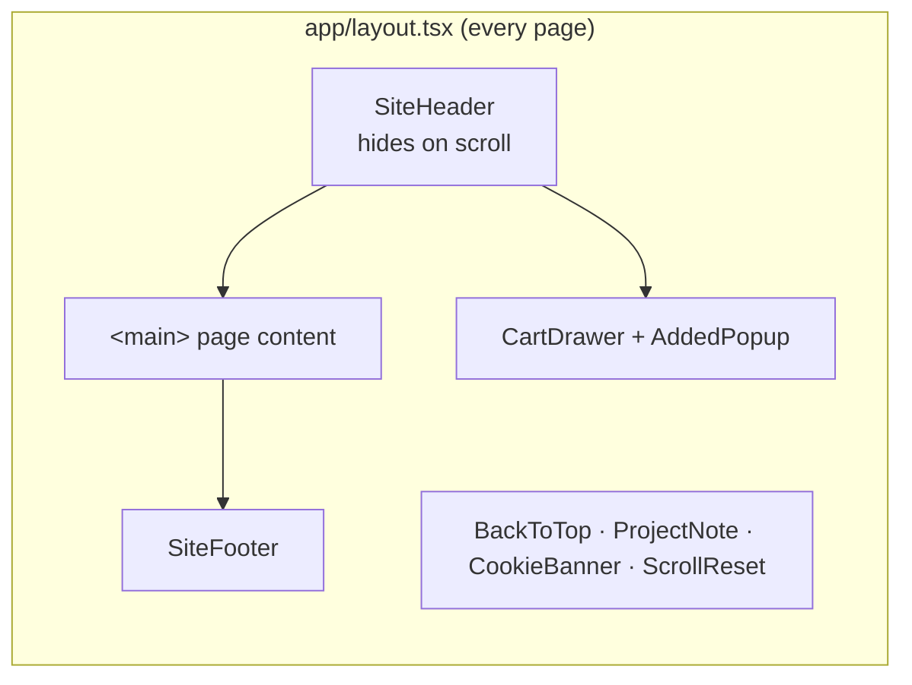
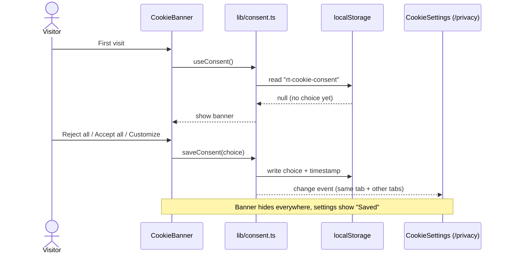

<div align="center">

# REP THEORY

### Gear and training programs built for the last rep.

[](https://rep-theory.vercel.app)
[](https://securityheaders.com/?q=https%3A%2F%2Frep-theory.vercel.app)


-0e0e0e?style=flat-square&logo=stripe&logoColor=635BFF)


**CP340-B · E-commerce · Wilfrid Laurier University · Fall 2026**

[Live site](https://rep-theory.vercel.app) · [Assignment 2](#-assignment-2-checklist) · [Features](#-features) · [Architecture](#-architecture) · [Getting started](#-getting-started) · [Roadmap](#-roadmap)

</div>

---

## 📌 About

Rep Theory is a concept e-commerce store for **lifting gear** (straps, wraps, cable attachments, clips) and **12-week training programs**. Anyone can do the first rep; we make gear and plans for the one after you want to quit.

Built for CP340-B: **Assignment 1** launched the storefront; **Assignment 2** added a working cart, Stripe checkout (one-time purchases and a monthly coaching subscription), content marketing, social media and SEO. Assignment 3 (analytics and engagement) is next.

> [!NOTE]
> **Rep Theory is not a real brand.** Products, prices, programs and the coach are made up for the course. Checkout runs in **Stripe test mode**: no real money moves and nothing ships. Pay with `4242 4242 4242 4242`, any future date, any CVC.

---

## 👥 Team

| | Name | Role |
|:-:|---|---|
| 01 | **Ronnie Abed** | Developer · Back end |
| 02 | **Harsh Shekhar** | Developer · Full stack |
| 03 | **Amaan Ali** | Former member (dropped the course) · built the site, still consulting |

All three of us are BSc Computer Science students at Wilfrid Laurier University.

---

## ✅ Assignment 1 checklist

| Requirement | Where it lives | Status |
|---|---|:-:|
| Home page | [`/`](https://rep-theory.vercel.app/) | ✅ |
| Blog page | [`/blog`](https://rep-theory.vercel.app/blog) | ✅ |
| Introductory post on the site's purpose | [`/blog/welcome`](https://rep-theory.vercel.app/blog/welcome) | ✅ |
| About page | [`/about`](https://rep-theory.vercel.app/about) | ✅ |
| Product page, 5+ products/services | [`/equipment`](https://rep-theory.vercel.app/equipment) (6) + [`/programs`](https://rep-theory.vercel.app/programs) (4) | ✅ 10 |
| Privacy settings | [`/privacy`](https://rep-theory.vercel.app/privacy) · [cookie settings](https://rep-theory.vercel.app/privacy#cookie-settings) · security headers | ✅ |

---

## ✅ Assignment 2 checklist

| Requirement | Where it lives | Status |
|---|---|:-:|
| Shopping cart: add, remove, update, persists across pages, details + totals | [`/cart`](https://rep-theory.vercel.app/cart) · mini cart from **CART** in the header | ✅ |
| Payment gateway: secure checkout + order confirmation | Stripe Checkout (test mode) → `/checkout/success` · `/checkout/cancelled` | ✅ |
| SEO: keywords, meta titles/descriptions, alt text | Every page's metadata · [`/sitemap.xml`](https://rep-theory.vercel.app/sitemap.xml) · [`/robots.txt`](https://rep-theory.vercel.app/robots.txt) · JSON-LD | ✅ |
| Content marketing: 3 original blog posts | [`/blog`](https://rep-theory.vercel.app/blog) (3 × ~560 words + intro post) | ✅ |
| Social media: icons/feed | Footer icons · "Follow the build" section on [`/`](https://rep-theory.vercel.app/) and [`/blog`](https://rep-theory.vercel.app/blog) | ✅ |
| Plans, strategy, evidence + report | Group report (PDF) | 📝 |

---

## ✨ Features

<table>
<tr>
<td width="50%" valign="top">

**🏋️ Storefront**
- Animated "past the failure line" hero, built in code instead of stock video
- Blueprint SVG drawing for every product
- Gear pages where the drawing updates live with **colour, size, grip, length and custom text**
- Category accordion and a sticky, scroll-aware Equipment nav

</td>
<td width="50%" valign="top">

**📋 Programs**
- 12-week block overview with deloads and a diet break
- Sample weeks whose gear tags link to products
- Sample day of eating, FAQs, and a plan comparison table
- 1:1 coaching page, plus a free assessment marked as coming soon

</td>
</tr>
<tr>
<td width="50%" valign="top">

**📝 Journal**
- 4 posts: setting up lifting straps, deload weeks, cutting without losing strength, and the intro post
- Topic filters (kept in the URL, e.g. `/blog?topic=training`) that highlight matching posts
- **Scroll-spy** contents, diagrams, "gear in this post" cards and share links (X, Facebook, LinkedIn, copy)

</td>
<td width="50%" valign="top">

**🔒 Privacy & security**
- First-visit **cookie banner**: optional cookies off by default
- **Cookie settings** saved in `localStorage`, synced across tabs
- PIPEDA-based privacy policy
- CSP, HSTS, X-Frame-Options and 3 more headers, rated **A**

</td>
</tr>
<tr>
<td width="50%" valign="top">

**🛒 Cart & checkout**
- Cart saved in the browser and re-validated on every read
- Slide-in **mini cart**, quantity steppers with a floor of 1, remove with an **Undo**
- Free-shipping progress bar ($75 of gear), 13% Ontario HST, shipping as its own line
- **Stripe Checkout** in test mode: one-time items and a **monthly coaching subscription** in one cart
- Order confirmed page built from Stripe's own record (order number, email, ship-to, card ending)
- Guest checkout, plus a "Read before you pay" panel of Stripe test cards (approved, declined, 3D Secure)

</td>
<td width="50%" valign="top">

**📣 SEO & social**
- Unique title, description, keywords and canonical URL on every page
- Open Graph + Twitter cards with a generated share image
- `sitemap.xml`, `robots.txt`, JSON-LD for Organization, Product and BlogPosting
- Alt text on every product drawing and diagram
- Instagram-style "Follow the build" profile with 6 planned posts and 4 content pillars; footer icons

</td>
</tr>
</table>

**♿ Accessibility:** keyboard-friendly drawers (Esc to close, focus stays inside), `aria` states on toggles and accordions, skip link, and `prefers-reduced-motion` respected everywhere.

---

## 🏗 Architecture

### How it's built and served



Almost every page is **pre-rendered at build time** and served as static HTML from Vercel's CDN. Only two routes run server code: `/api/checkout` (creates the Stripe session) and `/checkout/success` (reads the paid session back from Stripe). There's no database: the cart lives in the browser and Stripe is the record of payment.

### Checkout flow



The secret key only exists on the server (`STRIPE_SECRET_KEY`, test keys only). Card details are typed on Stripe's page, never ours.

### One data source, every page



To add a product, add one entry to `src/data/catalog.ts`. Its card, detail page, related links and sample-week tags are all generated from that entry.

### Page shell



### Cookie consent flow



---

## 🗂 Project structure

```
cp340/
├── next.config.ts              # Security headers (CSP, HSTS, X-Frame-Options…)
└── src/
    ├── app/                    # Routes (Next.js App Router)
    │   ├── layout.tsx          # Shell: header, footer, banner, project note + SEO defaults
    │   ├── template.tsx        # Fade-up page transition on every navigation
    │   ├── page.tsx            # /
    │   ├── equipment/          # /equipment, /equipment/[slug]
    │   ├── programs/           # /programs, /programs/[slug]
    │   ├── blog/               # /blog, /blog/[slug], /blog/welcome
    │   ├── about/              # /about
    │   ├── privacy/            # /privacy (+ #cookie-settings)
    │   ├── cart/               # /cart
    │   ├── api/checkout/       # POST: validate, re-price, create Stripe session
    │   ├── checkout/           # /checkout/success, /checkout/cancelled
    │   ├── sitemap.ts · robots.ts · opengraph-image.tsx
    │   └── globals.css         # Design tokens, shared animations
    ├── components/             # CartView, CartDrawer, TestCards, QtyStepper, GearCustomizer,
    │                           # JournalList, ShareBar, SocialBand, ScrollSpyToc, CookieBanner…
    ├── data/
    │   ├── catalog.ts          # Products + programs (single source of truth)
    │   └── journal.ts          # Blog posts + contact emails
    └── lib/
        ├── cart.ts             # Cart store (localStorage + useSyncExternalStore)
        ├── pricing.ts          # Validation, shipping, HST: shared by browser and server
        ├── stripe.ts           # Server-only Stripe client (refuses live keys)
        ├── useCartActions.ts   # Shared checkout + remove/undo logic
        ├── site.ts             # Site URL + social profiles
        └── consent.ts          # Cookie consent store
```

### Design tokens

| Token | Hex | Used for |
|---|---|---|
| `ink` | `#0e0e0e` | Text, dark bands |
| `chalk` | `#eceae4` | Page background |
| `accent` | `#ff5a1f` | Highlights, hover shadows |
| `ember` | `#b8400f` | Links on hover, numbering |
| `caution` | `#f2c94c` | Project note tab, test-mode notes |

Type: **Big Shoulders Display** (headlines) · **IBM Plex Sans / Mono** (body, labels) · **Instrument Serif** (pull quotes)

---

## 🚀 Getting started

This is a [Next.js](https://nextjs.org) project bootstrapped with [`create-next-app`](https://nextjs.org/docs/app/api-reference/cli/create-next-app).

**Requirements:** Node.js 20+ and npm.

```bash
git clone <this-repo-url>
cd cp340
npm install
npm run dev
# or: yarn dev · pnpm dev · bun dev
```

Open [http://localhost:3000](http://localhost:3000) with your browser. The page auto-updates as you edit files in `src/`.

**Checkout needs a Stripe test key.** Create `.env.local` in the project root (it's git-ignored, never commit it):

```bash
STRIPE_SECRET_KEY=sk_test_...        # Stripe Dashboard → Developers → API keys (test mode)
# NEXT_PUBLIC_SITE_URL=http://localhost:3000   # optional; defaults to the live URL
```

On Vercel, add the same `STRIPE_SECRET_KEY` under **Settings → Environment Variables** for Production and Preview. The app refuses to start checkout with anything other than an `sk_test_` key.

| Test card | Result |
|---|---|
| `4242 4242 4242 4242` | Payment succeeds |
| `4000 0000 0000 0002` | Declined |
| `4000 0000 0000 9995` | Insufficient funds |
| `4000 0025 0000 3155` | 3D Secure check |

Any future expiry, any CVC, any postal code.

| Script | What it does |
|---|---|
| `npm run dev` | Start the dev server with hot reload |
| `npm run build` | Production build (also type-checks) |
| `npm run start` | Serve the production build locally |
| `npm run lint` | Run ESLint |

This project uses [`next/font`](https://nextjs.org/docs/app/building-your-application/optimizing/fonts) to automatically optimize and self-host its Google Fonts.

---

## 🛣 Roadmap

- [x] **Assignment 1:** home, product pages, blog + intro post, about, privacy settings
- [x] **Assignment 2:** cart + mini cart, Stripe checkout with subscriptions, order confirmation, 3 blog posts, social section, SEO
- [ ] **Assignment 3:** analytics (only with cookie consent), live social accounts, customer engagement, free program assessment
- [ ] **Later:** accounts + Stripe customer portal for managing coaching subscriptions
- [ ] **Testing:** Playwright end-to-end tests in GitHub Actions on every push

---

## 📚 Learn more

To learn more about Next.js, take a look at the following resources:

- [Next.js Documentation](https://nextjs.org/docs): learn about Next.js features and API.
- [Learn Next.js](https://nextjs.org/learn): an interactive Next.js tutorial.

You can check out [the Next.js GitHub repository](https://github.com/vercel/next.js). Your feedback and contributions are welcome!

## ▲ Deploy on Vercel

The easiest way to deploy a Next.js app is the [Vercel Platform](https://vercel.com/new?utm_medium=default-template&filter=next.js&utm_source=create-next-app&utm_campaign=create-next-app-readme) from the creators of Next.js. This repo is connected to Vercel, so **every push to `main` deploys** to https://rep-theory.vercel.app.

Check out the [Next.js deployment documentation](https://nextjs.org/docs/app/building-your-application/deploying) for more details.

---

<div align="center">
<sub>© 2026 Rep Theory · CP340-B group project · Not a real brand</sub>
</div>
