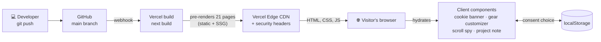
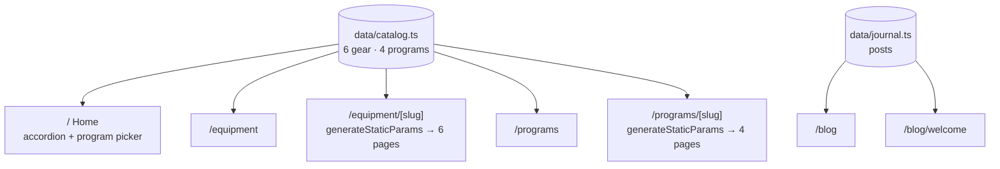
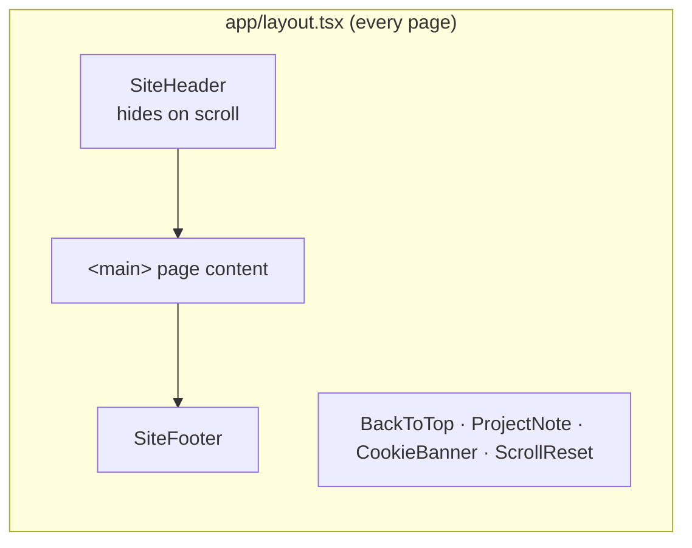
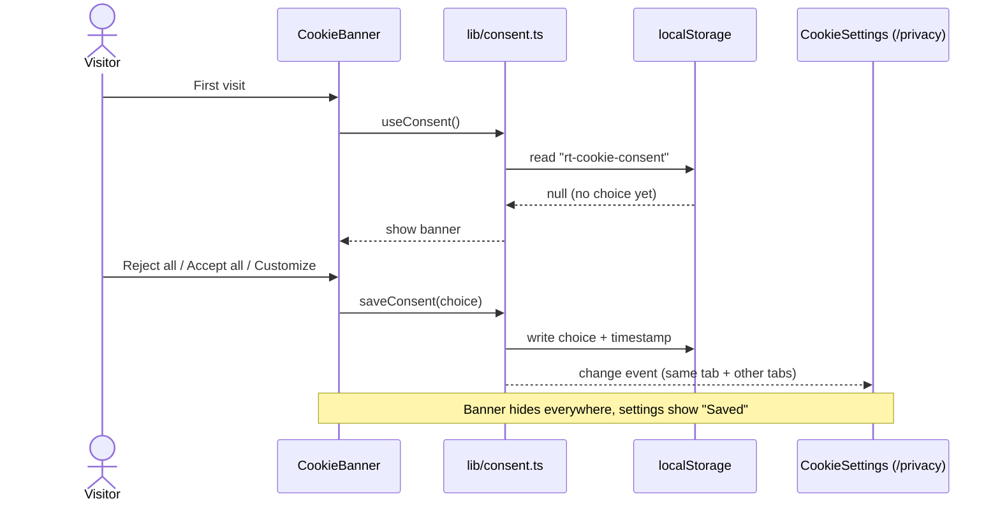

<div align="center">

# REP THEORY

### Gear and training programs built for the last rep.

[](https://rep-theory.vercel.app)
[](https://securityheaders.com/?q=https%3A%2F%2Frep-theory.vercel.app)


**CP340-B · E-commerce · Wilfrid Laurier University · Fall 2026**

[Live site](https://rep-theory.vercel.app) · [Features](#-features) · [Architecture](#-architecture) · [Getting started](#-getting-started) · [Roadmap](#-roadmap)

</div>

---

## 📌 About

Rep Theory is a concept e-commerce store for **lifting gear** (straps, wraps, cable attachments, clips) and **12-week training programs**. Anyone can do the first rep; we make gear and plans for the one after you want to quit.

The site was built for **Assignment 1** of CP340-B and is the foundation we'll keep developing through Assignments 2 and 3 (cart, checkout, SEO, analytics).

> [!NOTE]
> **Rep Theory is not a real brand.** Products, prices, programs and the coach are made up for the course. Checkout is switched off and no payment details are ever collected.

---

## 👥 Team

| | Name | Role |
|:-:|---|---|
| 01 | **Amaan Ali** | Developer · Front end + design |
| 02 | **Ronnie Abed** | Developer · Back end |
| 03 | **Harsh Shekhar** | Developer · Full stack |

All three of us are BSc Computer Science students at Wilfrid Laurier University.

---

## ✅ Assignment 1 checklist

| Requirement | Where it lives | Status |
|---|---|:-:|
| Home page | [`/`](https://rep-theory.vercel.app/) | ✅ |
| Blog page | [`/blog`](https://rep-theory.vercel.app/blog) | ✅ |
| Introductory post on the site's purpose | [`/blog/welcome`](https://rep-theory.vercel.app/blog/welcome) | ✅ |
| About page | [`/about`](https://rep-theory.vercel.app/about) | ✅ |
| Product page, 5+ products/services | [`/equipment`](https://rep-theory.vercel.app/equipment) (6) + [`/programs`](https://rep-theory.vercel.app/programs) (4) | ✅ 10 |
| Privacy settings | [`/privacy`](https://rep-theory.vercel.app/privacy) · [cookie settings](https://rep-theory.vercel.app/privacy#cookie-settings) · security headers | ✅ |

---

## ✨ Features

<table>
<tr>
<td width="50%" valign="top">

**🏋️ Storefront**
- Animated "past the failure line" hero, built in code instead of stock video
- Blueprint SVG drawing for every product
- Gear pages where the drawing updates live with **colour, size, grip, length and custom text**
- Category accordion and a sticky, scroll-aware Equipment nav

</td>
<td width="50%" valign="top">

**📋 Programs**
- 12-week block overview with deloads and a diet break
- Sample weeks whose gear tags link to products
- Sample day of eating, FAQs, and a plan comparison table
- 1:1 coaching page, plus a free assessment marked as coming soon

</td>
</tr>
<tr>
<td width="50%" valign="top">

**📝 Journal**
- Introductory post with a **scroll-spy** table of contents
- Homepage section links jump straight to each part of the post

</td>
<td width="50%" valign="top">

**🔒 Privacy & security**
- First-visit **cookie banner**: optional cookies off by default
- **Cookie settings** saved in `localStorage`, synced across tabs
- PIPEDA-based privacy policy
- CSP, HSTS, X-Frame-Options and 3 more headers, rated **A**

</td>
</tr>
</table>

**♿ Accessibility:** keyboard-friendly drawers (Esc to close, focus stays inside), `aria` states on toggles and accordions, skip link, and `prefers-reduced-motion` respected everywhere.

---

## 🏗 Architecture

### How it's built and served



Every page is **pre-rendered at build time**, so there's no server code or database at runtime. Each visit gets static HTML from Vercel's CDN, and React hydrates only the interactive parts.

### One data source, every page



To add a product, add one entry to `src/data/catalog.ts`. Its card, detail page, related links and sample-week tags are all generated from that entry.

### Page shell



### Cookie consent flow



---

## 🗂 Project structure

```
cp340/
├── next.config.ts              # Security headers (CSP, HSTS, X-Frame-Options…)
└── src/
    ├── app/                    # Routes (Next.js App Router)
    │   ├── layout.tsx          # Shell: header, footer, banner, project note
    │   ├── page.tsx            # /
    │   ├── equipment/          # /equipment, /equipment/[slug]
    │   ├── programs/           # /programs, /programs/[slug]
    │   ├── blog/               # /blog, /blog/welcome
    │   ├── about/              # /about
    │   ├── privacy/            # /privacy (+ #cookie-settings)
    │   ├── cart/               # /cart (placeholder until checkout)
    │   └── globals.css         # Design tokens, shared animations
    ├── components/             # Hero, GearDrawing, GearCustomizer, ProgramSheet,
    │                           # ScrollSpyToc, CookieBanner, CookieSettings, ProjectNote…
    ├── data/
    │   ├── catalog.ts          # Products + programs (single source of truth)
    │   └── journal.ts          # Blog posts + contact emails
    └── lib/
        └── consent.ts          # Cookie consent store (useSyncExternalStore)
```

### Design tokens

| Token | Hex | Used for |
|---|---|---|
| `ink` | `#0e0e0e` | Text, dark bands |
| `chalk` | `#eceae4` | Page background |
| `accent` | `#ff5a1f` | Highlights, hover shadows |
| `ember` | `#b8400f` | Links on hover, numbering |
| `caution` | `#f2c94c` | Project note tab |

Type: **Big Shoulders Display** (headlines) · **IBM Plex Sans / Mono** (body, labels) · **Instrument Serif** (pull quotes)

---

## 🚀 Getting started

This is a [Next.js](https://nextjs.org) project bootstrapped with [`create-next-app`](https://nextjs.org/docs/app/api-reference/cli/create-next-app).

**Requirements:** Node.js 20+ and npm.

```bash
git clone <this-repo-url>
cd cp340
npm install
npm run dev
# or: yarn dev · pnpm dev · bun dev
```

Open [http://localhost:3000](http://localhost:3000) with your browser. The page auto-updates as you edit files in `src/`.

| Script | What it does |
|---|---|
| `npm run dev` | Start the dev server with hot reload |
| `npm run build` | Production build (also type-checks) |
| `npm run start` | Serve the production build locally |
| `npm run lint` | Run ESLint |

This project uses [`next/font`](https://nextjs.org/docs/app/building-your-application/optimizing/fonts) to automatically optimize and self-host its Google Fonts.

---

## 🛣 Roadmap

- [x] **Assignment 1:** home, product pages, blog + intro post, about, privacy settings
- [ ] **Assignment 2:** working cart, checkout/payment demo (Stripe test mode), SEO (sitemap, metadata, structured data)
- [ ] **Assignment 3:** analytics (only with cookie consent), social integration, customer engagement, free program assessment
- [ ] **Testing:** Playwright end-to-end tests in GitHub Actions on every push

---

## 📚 Learn more

To learn more about Next.js, take a look at the following resources:

- [Next.js Documentation](https://nextjs.org/docs): learn about Next.js features and API.
- [Learn Next.js](https://nextjs.org/learn): an interactive Next.js tutorial.

You can check out [the Next.js GitHub repository](https://github.com/vercel/next.js). Your feedback and contributions are welcome!

## ▲ Deploy on Vercel

The easiest way to deploy a Next.js app is the [Vercel Platform](https://vercel.com/new?utm_medium=default-template&filter=next.js&utm_source=create-next-app&utm_campaign=create-next-app-readme) from the creators of Next.js. This repo is connected to Vercel, so **every push to `main` deploys** to https://rep-theory.vercel.app.

Check out the [Next.js deployment documentation](https://nextjs.org/docs/app/building-your-application/deploying) for more details.

---

<div align="center">
<sub>© 2026 Rep Theory · CP340-B group project · Not a real brand</sub>
</div>
